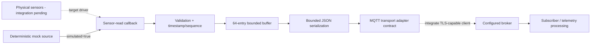

# 🔧 STM32 Edge Sensor Node
### Embedded C · Industrial Telemetry · MQTT Integration Boundary

<div align="center">

[](https://en.cppreference.com/w/c/11.html)
[](tests/)
[](docs/mqtt-protocol.md)
[](.github/workflows/)
[](LICENSE)

**A portable firmware core for bounded sensor acquisition and structured edge telemetry.**

</div>

---

## Engineering overview

This project is a reference architecture for an embedded telemetry node. Portable C modules define a bounded data buffer, a validated sensor-read callback, and capacity-checked JSON serialization. A deterministic Python simulator produces reproducible telemetry records for schema and integration tests. MQTT is represented by a transport-adapter contract so a target-specific networking stack can be integrated without falsely implying that a generic host build is already STM32 firmware.

> **Hardware boundary:** no MCU part number, development board, sensor BOM, network interface, vendor HAL, cross-compiler target, or flashing setup was selected for this project. It has not been flashed to an STM32. The C MQTT module is an interface contract, not a complete network/TLS client. Generated sensor readings explicitly carry `"simulated": true`.

## Design requirements and decisions

| Area | Implementation | Engineering rationale |
|---|---|---|
| Memory | Fixed-capacity ring buffer (64 records) | Bounded storage and predictable allocation behavior |
| Backpressure | Drop-newest behavior when full, with drop counter | Makes queue overload explicit and testable |
| Sensor API | Injected acquisition callback | Keeps board-specific HAL/driver details out of portable logic |
| Integrity | Rejects failed reads, non-finite fields and negative vibration RMS | Prevents invalid payload values from entering the normal path |
| Data contract | Timestamp, sequence, temperature, vibration RMS, simulated provenance | Explicit schema for downstream consumers and replay |
| Serialization | Capacity-checked JSON serialization | Never silently treats a truncated payload as valid |
| Transport seam | MQTT connect/publish/disconnect callback contract | Allows a selected client library and TLS stack to be integrated later |
| Validation | Host C tests, Python schema tests and strict compiler flags | Fast regression checks before target selection |

## System architecture



Dotted edges are unimplemented integration seams, not verified end-to-end hardware paths.

## Repository map

```text
firmware/App/
  data_buffer.[ch]      # Ring buffer and overflow policy
  sensor_manager.[ch]  # Validated reading callback boundary
  telemetry.[ch]       # Bounded JSON serializer
  mqtt_client.[ch]     # Transport adapter contract only
simulator/
  mock_sensor.py       # Deterministic simulated JSONL telemetry
  mqtt_subscriber.py   # Optional Paho subscriber with TLS validation
tests/
  test_firmware.c      # Host-compiled C assertions
  test_simulator.py    # Determinism and telemetry-schema tests
config/                # Example-only settings; no live credentials
hardware/              # BOM and board-integration placeholders
docs/                  # Architecture, protocol, wiring and bring-up notes
.github/workflows/     # Host tests and compiler checks
```

## Quick start: host validation

Prerequisites: Python 3.10+, a C11-compatible host compiler (`cc`), and pytest. These steps run on the host and **do not cross-compile for an STM32**.

```bash
git clone https://github.com/shivtejsalunke/stm32-edge-sensor-node-.git
cd stm32-edge-sensor-node-
python3 -m pip install -r requirements-dev.txt
make test
```

Run the complete software demo:

```bash
bash scripts/run_demo.sh
```

The demo generates 20 deterministic records in `results/sample_telemetry.jsonl`, compiles the portable C modules with strict warning flags, runs C assertions, and executes Python tests. Simulated readings stay marked `simulated: true`; do not present them as physical sensor data.

## Telemetry schema

Each JSONL record follows this schema:

```json
{
  "timestamp_ms": 1000,
  "sequence": 1,
  "temperature_c": 25.123,
  "vibration_rms": 0.081234,
  "simulated": true
}
```

Values are illustrative. Timestamp and sequence are millisecond/counter fields. Temperature is expressed in degrees Celsius. `vibration_rms` is a non-negative scalar, but its physical unit and scaling must be defined by the real sensor pipeline. The simulator creates artificial values, not calibrated measurements.

See [the MQTT protocol note](docs/mqtt-protocol.md) for the suggested topic and transport assumptions. The firmware adapter does not currently publish messages itself: implement it against the chosen MQTT library and target network stack before claiming broker integration.

### Optional TLS-verifying MQTT subscriber

Given an existing trusted broker and route, install Paho and run:

```bash
python3 -m pip install 'paho-mqtt==2.1.0'
python simulator/mqtt_subscriber.py \
  --host YOUR_BROKER_HOST \
  --port 8883 \
  --topic demo/shivtej/sensor-node/telemetry \
  --ca /path/to/trusted-ca.pem
```

TLS certificate validation is enabled by default. The `--insecure-local-demo` option disables transport security and must be confined to an isolated local demonstration network—never production or an untrusted network. The mock generator writes JSONL to disk; it does not publish MQTT messages.

## Firmware core behavior

### Buffer and overload semantics
The buffer capacity is 64 records. When full, push rejects the newest record and increments a drop counter rather than silently overwriting unread samples. This is an explicit demonstrator policy, not universally correct for industrial systems. A real design must choose drop-newest, drop-oldest, backpressure, or alarm behavior based on data criticality and timing constraints.

### Sensor acquisition seam
The sensor manager accepts a callback so board-specific I2C/SPI/ADC drivers can be added behind a stable API. It checks null pointers, failed reads, non-finite values and negative vibration RMS. Real driver integration, calibration, unit conversion, DMA/interrupt scheduling, timing guarantees and sensor diagnostics remain target-specific work.

### Bounded serialization
The serializer validates pointers, finite numerical values and destination capacity. Callers must treat a failed serialization as an error path; never transmit truncated JSON as valid telemetry.

## Reliability and security checklist

- Keep broker credentials, private keys, Wi-Fi secrets and client certificates out of Git.
- Use a maintained MQTT stack with certificate validation and an intentional trust store.
- Define client authentication, least-privilege topic ACLs, reconnect/backoff, keep-alive, publish QoS and message-size limits.
- Specify queue-overflow behavior and how broker unavailability is surfaced.
- Document timestamp source/rollover, sequence rollover, sampling deadline budget and reset/power-loss behavior.
- Add calibration, units conversion, plausibility checks and sensor-disconnect detection.
- Run target-toolchain static analysis and board tests. A host compile does not establish MCU compatibility.

## Current status

- ✅ Portable C ring buffer, explicit drop counter, sensor-read callback and bounded JSON serialization.
- ✅ Deterministic simulator and sample JSONL, host C assertions and Python schema tests.
- ✅ Optional MQTT subscriber with TLS certificate verification enabled by default.
- ✅ CI workflows for host tests and strict C compilation.
- ⏳ No selected STM32 board, sensor part, physical wiring, or verified component BOM.
- ⏳ No STM32 cross-build, firmware flashing, logic-analyzer/oscilloscope validation, physical sensor tests or power/timing measurements.
- ⏳ MQTT transport implementation in C, TLS credential provisioning, reconnect state machine and broker end-to-end testing are integration work.

## Board bring-up plan

1. Select the exact STM32 part/board and identify flash/RAM budget, clocking, interfaces, supported compiler and HAL.
2. Select sensor part numbers and document supply voltage, wiring, calibration, range, bandwidth and sample cadence.
3. Implement the sensor-read callback with the target driver and measure acquisition latency and missed samples.
4. Select the network interface; integrate a maintained MQTT client with TLS and secure credential provisioning.
5. Add target build files, linker map, flash/debug instructions and a cross-build CI job.
6. Validate reconnect behavior, queue pressure, malformed readings, resets, packet loss and long-run stability on hardware.
7. Publish measured RAM/flash use, timing evidence and limitations against the exact board/toolchain revision.

## License

Original project code is MIT-licensed. Future vendor HAL, SDK, sensor-driver and MQTT-library code must retain its own upstream license and attribution.

---

<div align="center"><b>Portable by interface. Explicit about failure modes. Honest about hardware evidence.</b></div>
